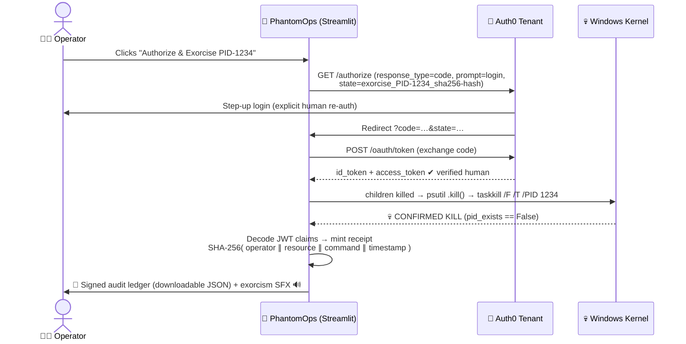

# 👻 PhantomOps — Local Infrastructure Ghost & Anomaly Exorcist

> **Zero-cloud-leakage FinOps & kernel agent.** Find the ghosts haunting your Windows kernel or your cloud bill → run a local AI autopsy → interrogate them in a live voice séance → get human clearance through Auth0 → put them to rest with a signed cryptographic receipt and a synthetic exorcism scream.

*Built for the Hacktoberfest Open-Source AI Challenge: **Ghost in the Machine** 🎃🌼*

Every machine has ghosts. The staging server that nobody killed in March. The script that leaked memory for 400 hours while everyone went home. The GPU instance cryptojacking at 3 AM. They drain your RAM and your budget — invisible, unaccounted for, *undead*. PhantomOps is a paranormal investigator for your infrastructure: it sees them, names them, questions them, and (with a human's blessing) banishes them — **entirely on your own hardware**.

---

## 🪦 The Haunting — What It Does

| Phase | What Happens | The Open AI Doing the Work |
|---|---|---|
| 👁️ **Sight** | Snapshots **every live process** on your Windows kernel (or a synthetic cloud estate) | `psutil` + local telemetry |
| 🔮 **Divination** | Zero-shot anomaly scoring, doomsday cost forecasting, counterfactual blame attribution | **TabPFN-3.5-Fast** (local `.safetensors` weights, CPU-only) |
| 🧠 **Autopsy** | Structured root-cause reports and first-person séance roleplay — the ghost *speaks* | **Google Gemma 2 2B** via Ollama (fully local) |
| 🔐 **Rite of Clearance** | No exorcism without a human: Auth0 step-up re-authentication binds an operator to the kill | **Auth0** OAuth2 + JWT + SHA-256 receipts |
| 🎙️ **Séance** | You speak, the ghost answers in a haunted voice, and an exorcism SFX plays when it dies | **ElevenLabs** `scribe_v1` STT + `multilingual_v2` TTS + Text-to-Sound-Effects |
| 💀 **Exorcism** | Real process-tree termination (children first), then silence | `psutil` + native `taskkill` |

The core loop — **scan → detect → reason → kill** — runs with the internet unplugged. No telemetry, metric, or log ever leaves your machine.

---

## ⚙️ The Séance Architecture — How It Works

```
                        👻  P H A N T O M O P S   P I P E L I N E  👻

   ┌─────────────────────────────┐      ┌─────────────────────────────────┐
   │   🖥️  LIVE KERNEL SCANNER   │      │   ☁️  CLOUD TELEMETRY (CSV)     │
   │   psutil: every PID is a    │      │   600 records, ~5% injected     │
   │   separate suspect (even    │      │   anomalies: zombie_gpu ·       │
   │   each browser TAB)         │      │   phantom_leaker · cryptojack   │
   └──────────────┬──────────────┘      └───────────────┬─────────────────┘
                  └───────────────────┬─────────────────┘
                                      ▼
                    ┌───────────────────────────────────┐
                    │   🔮  TABPFN-3.5-FAST  (LOCAL)    │
                    │   • Classifier → ghost_confidence │
                    │   • Regressor → 30-day doomsday   │
                    │   • Counterfactuals → feature     │
                    │     blame attribution             │
                    └─────────────────┬─────────────────┘
                                      ▼  flagged ghosts only
                    ┌───────────────────────────────────┐
                    │   🧠  GEMMA 2 2B via OLLAMA       │
                    │   • JSON autopsy (Pydantic-bound) │
                    │   • Séance roleplay: the ghost    │
                    │     answers in first person       │
                    └─────────────────┬─────────────────┘
                                      ▼
              ┌───────────────────────┴───────────────────────┐
              ▼                                               ▼
   ┌────────────────────────┐                   ┌────────────────────────────┐
   │  🔐  AUTH0 GATEKEEPER  │                   │  🎙️  ELEVENLABS VOICE BOX  │
   │  Step-up OAuth2        │                   │  scribe_v1 STT (you speak) │
   │  (prompt=login) before │                   │  multilingual_v2 TTS ×2    │
   │  ANY destructive act   │                   │  (Commander + Haunted)     │
   │  → SHA-256 receipt     │                   │  text-to-sfx (exorcism)    │
   └───────────┬────────────┘                   └────────────────────────────┘
               ▼
   ┌────────────────────────────────────────────────────────────────┐
   │  💀  EXORCISM ENGINE (src/live_scanner.py)                     │
   │  child processes killed first → psutil .kill() →               │
   │  native taskkill /F /T /PID → JWT claims decoded →             │
   │  tamper-evident receipt: operator ∥ resource ∥ command ∥ time  │
   └────────────────────────────────────────────────────────────────┘
```

### Stage 1 — Telemetry Ingestion (two hauntings, one investigator)

**🖥️ Live mode** — `src/live_scanner.py` walks the **entire Windows process table** with `psutil.process_iter`, and builds one full evidence file per PID: RAM footprint, CPU %, thread count, uptime, command line, and an estimated hourly cost (`mem_mb×0.0008 + cpu%×0.015 + threads×0.004`). A cmdline check tags any running `spawn_zombie.py` as an unmistakable `zombie_runaway_script`. Heuristic classes catch the rest: `live_memory_hog` (>4% RAM), `live_cpu_runaway` (>50% CPU), `thread_bloated_daemon` (>85 threads).

**☁️ Cloud mode** — `src/generator.py` synthesizes a 600-record enterprise billing estate (real AWS instance pricing across 4 regions) and injects ~5% anomalies: abandoned `zombie_gpu` instances at 0.1% CPU burning $880/month, `phantom_leaker`s, `cryptojack_spike`s, and `defunct_daemon`s. You can also drop in your own CSV.

### Stage 2 — Detection (TabPFN-3.5-Fast, strictly local)

`src/detector.py` sets `TABPFN_OFFLINE=1` and `TABPFN_DISABLE_AUTH=1` — **the model never phones home**. Weights load from `models/tabpfn-v3.5-fast-20260909.safetensors` on CPU (threads pinned to 4 for laptop thermals). The classifier fits on baseline signatures and scores the rest of the estate zero-shot, producing a `ghost_confidence` per resource. Confidence gates: **0.55** (cloud test split) / **0.50** (live full-scan) — and any live `spawn_zombie.py` is pinned to **0.9999** and locked to the top of the Phantom Queue (see the spotlight below).

### Stage 3 — Reasoning (Gemma 2 2B, Pydantic-bound)

`src/reasoner.py` feeds the flagged telemetry to a **local Gemma 2 2B** through Ollama and demands structured JSON back, enforced by a Pydantic `GhostAutopsy` schema: `incident_title`, `severity`, `root_cause_autopsy`, `monthly_waste_usd`, and an exact, environment-aware `exorcism_command` (`taskkill /F /T /PID <pid>` for kernel ghosts, `aws ec2 terminate-instances` for cloud spirits). The same model then switches roles for the séance — first-person, dramatic, technically accurate to its own real metrics.

### Stage 4 — Authorization (Auth0, the ward that protects you)

`src/gatekeeper.py` implements **human-in-the-loop step-up authorization**: destructive actions generate an OAuth2 authorization URL with `prompt=login` (forcing explicit re-authentication) and a SHA-256 `state` that binds the request to the exact resource + command. On callback, the code is exchanged for tokens, the JWT payload is decoded in-process (no external deps), and a **tamper-evident execution receipt** is minted: `EXOR-XXXXXXXXXX`, binding `operator_sub | resource_id | authorized_command | timestamp`.

### Stage 5 — Voice (ElevenLabs, the medium)

`src/narrator.py` orchestrates three distinct ElevenLabs APIs: **`scribe_v1`** transcribes your spoken séance questions, **`multilingual_v2`** speaks on both sides of the veil (an authoritative *Commander* voice for incident briefings, and the hoarse *Callum* voice for the dying process), and **Text-to-Sound-Effects** synthesizes a "sci-fi server rack power down with a ghostly digital whoosh" the moment a ghost is banished. All audio is cached locally to conserve credits.

---

## 🖥️ Spotlight — The Live Kernel Detector Is Scary Good

This isn't a canned demo on fake data. The live scanner runs against your **real, current OS state**, and it has two properties that make the séance feel supernatural:

### 1. Per-tab precision — it sees *individual* browser tabs, not "a browser"

`psutil.process_iter` enumerates **every PID independently** — and Chromium-based browsers (Chrome, Edge, Brave) spawn a **separate renderer process for every active tab**. PhantomOps never collapses them: two active tabs each carrying a runaway page surface as **two distinct suspects**, each with its own PID, RAM footprint, thread count and evidence trail. You interrogate and exorcise the exact haunted tab — not "browser.exe" and its 40 innocent siblings. One suspect, one verdict, one kill.

### 2. 99.99% certainty on live zombies

Run `python spawn_zombie.py` — it allocates a real **700 MB RAM block** and burns CPU in an infinite loop. The moment PhantomOps scans, the cmdline fingerprint (`spawn_zombie`) identifies it, its confidence is pinned to **`0.9999`**, and it is **locked to the top of the Phantom Queue**. No ambiguity, no "maybe": when the scanner sees the anomaly, it is **99.99% sure** — and the exorcism button is one Auth0 clearance away. Real PID, real kill, confirmed by `psutil.pid_exists()` going false.

### 3. It kills carefully

The exorcist kills the **entire process tree** (children first), follows up with a native `taskkill /F /T /PID`, and cleans up `.venv` parent launchers. It refuses to harm: its own Streamlit process (self-preservation lock), and a protected list (`code.exe`, `cursor.exe`, `explorer.exe`, `svchost.exe`, `ollama.exe`, system) — unless the target is explicitly the zombie. Paranormal cleanup, professional liability standards.

*(If fewer than 2 ghosts exist on a quiet machine, the scanner flags the top-4 RAM consumers so the séance always has someone to summon.)*

---

## 🔮 The Exorcism Rite — Auth0 Flow, Step by Step

No ghost dies without a living human's signature. The full authorization sequence:



The `state` parameter is a SHA-256 fingerprint of `resource_id:command` — the authorization is cryptographically bound to **this** ghost and **this** kill command, so a callback can't be replayed against a different target. The resulting receipt (`receipt_id`, operator `sub`, `iss`, bound command, `sha256_action_binding`) is persisted to the audit ledger and downloadable as JSON.

---

## 📈 TabPFN Deep Dive — Three Models in One Open Brain

All three run **locally on CPU** from the same open-weight foundation model (`src/detector.py`):

1. **`TabPFNClassifier` — zero-shot ghost scoring.** Fits on baseline telemetry signatures, scores the remaining estate with no gradient training, no GPU, no data upload. Produces the `ghost_confidence` that drives the whole pipeline.
2. **`TabPFNRegressor` — the Doomsday Forecaster.** Fits utilization curves → hourly cost, then simulates 30 days of decay (memory +1.35%/day, CPU +0.4%/day, connections +1.5/day) to plot cumulative financial drain vs. the flat $0 line after exorcism — plus an *Estimated Time to OOM Crash* in hours.
3. **Counterfactual what-if simulator.** Drag sliders to mutate a ghost's telemetry in real time and watch TabPFN re-classify it as healthy — the exact moment the confidence drops tells you *which metric was haunting it*. Feature blame attribution is computed by resetting each feature to the estate median and measuring the probability drop: a zero-shot, perturbation-based explanation of the anomaly.

**Where the open approach beat a closed one:** TabPFN is a tabular foundation model that runs on a laptop CPU with 4 threads, needs zero training infrastructure, zero data egress, and zero per-prediction cost — a closed anomaly-detection API would have required shipping every process's telemetry (your entire running software inventory!) to someone else's servers to score it. Here, the most sensitive data your machine has never leaves it.

---

## 🏆 Sponsor Technology Map

For judges: every partner integration, where it lives, and what it does.

| Partner | Code | Role in the Haunting |
|---|---|---|
| **Prior Labs — TabPFN** (`tabpfn` pkg) | `src/detector.py` | Local anomaly classifier + cost regressor + counterfactual attribution engine. Offline safetensors weights, `TABPFN_OFFLINE=1`, CPU-only. |
| **Google — Gemma 2 2B** (Ollama) | `src/reasoner.py` | Structured JSON autopsies (Pydantic-enforced) + first-person séance roleplay of the haunted process. Fully local via Ollama. |
| **Auth0 — for AI Agents** | `src/gatekeeper.py`, `app.py` | Human-in-the-loop step-up OAuth2 gate on destructive agent actions, JWT claims decoding, SHA-256 tamper-evident execution receipts. |
| **ElevenLabs** | `src/narrator.py` | `scribe_v1` speech-to-text (your séance questions) · `multilingual_v2` dual-persona TTS (Commander briefings + haunted Callum ghost replies) · Text-to-Sound-Effects (exorcism power-down). |
| **Streamlit + Plotly + psutil** | `app.py`, `src/live_scanner.py` | Dark telemetry console, anomaly separation map, live kernel inventory. |

---

## 🚀 Quick Start — Summon It Yourself

**Prerequisites:** Python 3.10+, [Ollama](https://ollama.com) with `ollama pull gemma2:2b`, and optionally a TabPFN weight file at `models/tabpfn-v3.5-fast-20260909.safetensors` (falls back to the pip package's weights).

```bash
# 1. Clone the haunted grounds
git clone https://github.com/akshat-bit420/PhantomOps.git
cd PhantomOps

# 2. Create your ritual circle
python -m venv .venv
.venv\Scripts\activate          # Windows
pip install -r requirements.txt

# 3. Configure your wards (see table below)
copy .env.example .env           # or create .env manually

# 4. Hardware & local-model sanity check
python test_setup.py
```

### 🎬 The 60-Second Demo

```bash
# Terminal 1 — summon the ghost (a real 700 MB RAM zombie on YOUR machine)
python spawn_zombie.py

# Terminal 2 — open the séance
streamlit run app.py
```

1. Sidebar → **🖥️ Live Windows PC Kernel (psutil)** → **⚡ Scan Now**
2. Watch `PID-xxxx (spawn_zombie.py)` appear **at the top of the Phantom Queue at 99.99% confidence** 👻
3. Tab 1 → **🧠 Generate Local Gemma 2 Autopsy** → read the root-cause report → **🔊 Synthesize Commander Alert**
4. Tab 2 → record or type a question → **🕯️ Conduct Séance** → the zombie *answers in its own haunted voice*
5. Tab 3 → drag the memory slider down and watch TabPFN's ghost probability collapse — that's the counterfactual proof
6. Click **🛡️ Authorize & Exorcise via Auth0** → step-up login → 💀 the zombie dies for real, the exorcism SFX plays, and you download the signed audit receipt.

*(No Auth0/ElevenLabs keys? The app degrades gracefully: simulation-mode exorcisms still work, and the séance falls back to text. But the full ritual is worth configuring.)*

---

## 🗂️ Project Structure

```
PhantomOps/
├── app.py                  🎛️ Streamlit haunted console — 3 tabs, KPIs, Auth0 callback handler, persistent state
├── spawn_zombie.py         🧟 Demo prop — spawns a REAL 700 MB runaway process to hunt & exorcise
├── test_setup.py           ✅ Verifies PyTorch threads, TabPFN weights, and local Gemma before the séance
├── src/
│   ├── generator.py        ☁️ Synthetic 600-record cloud estate with injected zombie anomalies
│   ├── live_scanner.py     🖥️ psutil per-PID kernel snapshot (tab-level precision) + process-tree exorcist
│   ├── detector.py         🔮 TabPFN classifier + regressor + counterfactual/feature-blame engine (offline)
│   ├── reasoner.py         🧠 Gemma 2 autopsy generator (Pydantic schema) + séance roleplay
│   ├── gatekeeper.py       🔐 Auth0 step-up OAuth2 gatekeeper + JWT decode + SHA-256 audit receipts
│   └── narrator.py         🎙️ ElevenLabs STT / dual-voice TTS / exorcism SFX with local audio caching
├── data/telemetry_billing.csv   ☁️ Pre-generated sample estate
└── requirements.txt
```

## 🔐 Configuration (.env)

| Variable | Used By | Notes |
|---|---|---|
| `TABPFN_MODEL_PATH` | 🔮 detector | Path to local weights (e.g. `models/tabpfn-v3.5-fast-20260909.safetensors`) |
| `GEMMA_MODEL` | 🧠 reasoner | Ollama tag, default `gemma2:2b` |
| `AUTH0_DOMAIN` / `AUTH0_CLIENT_ID` / `AUTH0_CLIENT_SECRET` | 🔐 gatekeeper | Your Auth0 tenant; redirect URI must be `http://localhost:8501` |
| `ELEVENLABS_API_KEY` | 🎙️ narrator | Enables STT, TTS and SFX |
| `ELEVENLABS_VOICE_ID` | 🎙️ narrator | Commander voice (defaults to a multilingual preset) |
| `ELEVENLABS_GHOST_VOICE_ID` | 🎙️ narrator | Haunted voice, default `N2lVS1w4EtoT3dr4eOWO` (**Callum**) |

Secrets and model weights are git-ignored (`.env`, `models/*.safetensors`, `audio_cache/`).

---

## 🌑 Why Open Innovation Matters Here

PhantomOps only makes sense as an open-weight system — and not for ideology, for **architecture**.

- **The data is the most sensitive a machine has.** A full kernel inventory is a map of everything you do: every tool, every tab, every script. A closed detection API would mean shipping that map to someone else's server on every scan. With local TabPFN and local Gemma 2, **the telemetry never leaves the chassis** — the "zero-cloud-leakage" promise is enforced by physics, not by a privacy policy.
- **It runs with the lights (and internet) off.** Scan → detect → autopsy → séance-in-text → exorcism all work on an air-gapped laptop. That's exactly the state your machine is in when something is *already wrong* — an exorcist that needs WiFi is not an exorcist.
- **It costs $0 to run per prediction.** TabPFN scores on CPU from local weights; Gemma infers locally; nothing meters you per token. You can hunt ghosts all night.
- **The behavior is yours to change.** Swap `gemma2:2b` for any Ollama model in one env var. Load different TabPFN weights. Rewrite the séance persona's prompt to be funnier or more formal. A closed SaaS ghost-hunter is a black box that can vanish, be repriced, or silently change its model under you — an open one is a *spirit you keep*, not a service you rent.
- **Where open genuinely beat closed for us:** TabPFN gave zero-shot tabular anomaly scoring with no training loop and no GPU; Gemma 2 2B gave structured JSON with local enforcement of the schema; and the only pieces we *did* buy — ElevenLabs' voices and Auth0's identity ward — are optional decorations on an engine that runs entirely at home.

*The ghost stays in your machine. So does the exorcist.*

---

## 📜 License

MIT — do what you will, but remember: what you exorcise stays exorcised. 👻
